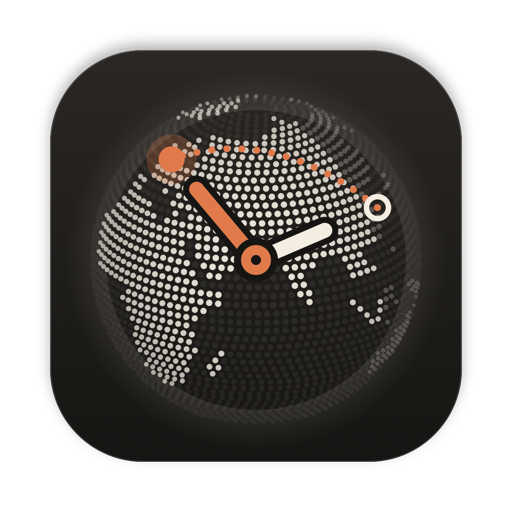
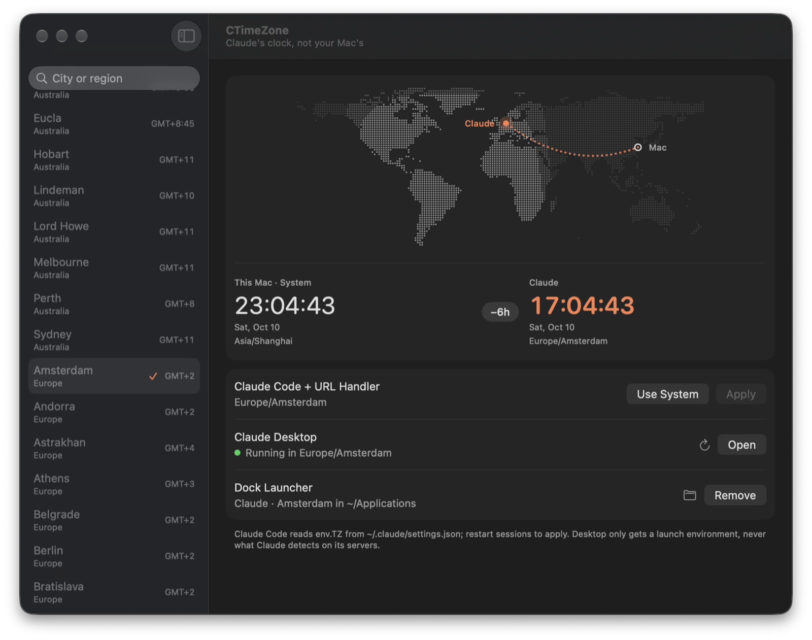

<p align="center">
  
</p>

<h1 align="center">CTimeZone</h1>

<p align="center">
  给 Claude 单独设置时区的原生 macOS 小工具，系统时区保持不变。<br>
  <em>Give Claude Code and Claude Desktop their own time zone without changing your Mac's.</em>
</p>

<p align="center">
  <a href="https://github.com/Snowyyyyyy1/CTimeZone/releases/latest">下载最新版</a>
</p>

<p align="center">
  
</p>

> 非官方项目，与 Anthropic 无关。“Claude” 是 Anthropic 的商标，这里只用来说明本工具作用的对象。

## 安装

1. 从 [Releases](https://github.com/Snowyyyyyy1/CTimeZone/releases) 下载 `CTimeZone-<版本>.dmg`，把 App 拖进「应用程序」。
2. App 没有 Apple Developer ID 签名，首次打开会被拦下。去「系统设置 → 隐私与安全性」点「仍要打开」，或执行：

   ```bash
   xattr -dr com.apple.quarantine /Applications/CTimeZone.app
   ```

要求 macOS 14 或更高。之后 App 会自动检查更新，也可以从菜单 **CTimeZone → 检查更新…（Check for Updates…）** 手动检查。

## 使用

界面跟随系统语言，支持简体中文和英文。下文按钮名先写中文，括号里是英文界面上的名字。

1. 在左侧搜索并选择时区（城市或地区，例如 `new york`）。
2. **应用（Apply）**：Claude Code 和 Claude Desktop 都改用这个时区。
3. **使用系统时区（Use System）**：两者都恢复系统时区。
4. **打开 / 重新启动（Open / Relaunch）**：按目标时区打开 Claude Desktop；如果它已经以别的时区在运行，会先确认再重启。

工作原理：

- **Claude Code**：写入 `~/.claude/settings.json` 的 `env.TZ`，其他字段不动。只对新开的会话生效。
- **Claude Desktop**：启动时注入 `TZ` 环境变量。只有经 CTimeZone 或 Dock 启动器打开才生效，直接点官方图标打开仍是系统时区。

每次修改 `settings.json` 前都会在同目录备份为 `settings.json.<UTC 时间>.bak`。

## Dock 启动器

在 **Dock 启动器（Dock Launcher）** 一行点 **添加到 Dock…（Add to Dock…）**，会在 `~/Applications` 生成 `Claude · <城市>.app`。把它拖进 Dock，以后直接点它打开 Claude：

| Claude 的状态 | 启动器的行为 |
|---|---|
| 没在运行 | 按目标时区启动 |
| 正在以目标时区运行 | 切到前台 |
| 正在以别的时区运行 | 询问 **重新启动（Relaunch）**（按目标时区重启）或 **直接打开（Just Open）**（直接切到前台） |

在 CTimeZone 里换时区后，启动器会自动改名，Dock 里的图标继续可用。Claude 运行时 Dock 里会同时出现启动器和 Claude 两个图标，建议把官方 Claude 图标移出 Dock。

## 隐藏 Mac 的时区

只改 `TZ` 不会隐藏 Mac 的真实时区。Claude Code 能执行命令，主动去查就能看到，例如 `readlink /etc/localtime`，或用 `defaults read` 读全局偏好设置里选中的城市。Claude Desktop 的普通聊天不能执行命令，不受影响。

打开 **隐藏 Mac 时区（Hide Mac Time Zone）** 开关，CTimeZone 会在 `~/.claude/settings.json` 里：

- 打开 Claude Code 自带的 sandbox（`sandbox.enabled`）；
- 在 `sandbox.filesystem.denyRead` 里禁止读取 `/etc/localtime`、`/private/etc/localtime` 和 `/Library/Preferences/.GlobalPreferences.plist`，上面两条命令都会失败；
- 在 `permissions.deny` 里加上对应的 `Read(...)` 规则，Claude 自带的读文件工具也读不到。

关掉开关只删除这些条目。如果 sandbox 是 CTimeZone 打开的，也会一并关掉；你自己原来开着的不动。

需要知道的局限：

- 打开 sandbox 后，Claude Code 执行的命令只能访问允许列表里的网络域名，其他域名会被拦下或询问。
- 语言和地区设置、`system_profiler`、出口 IP 仍然能看出你在哪里。
- `excludedCommands` 里的命令，以及经同意后脱离 sandbox 重试的命令，不受限制。auto mode 下这种重试可能不经询问就被自动同意，开关下方会一直显示这条提醒。

### 彻底隔离

需要彻底隔离时，在 [dev container](https://code.claude.com/docs/en/devcontainer) 里运行 Claude Code，让容器自己的系统时区就是目标时区。以官方[参考配置](https://github.com/anthropics/claude-code/tree/main/.devcontainer)为基础：

1. 在 `devcontainer.json` 里把构建参数 `TZ` 改成目标时区，例如 `"TZ": "Asia/Tokyo"`。默认值取宿主的 `TZ` 环境变量，没设时是 `America/Los_Angeles`。
2. 在 `Dockerfile` 的 `ENV TZ="$TZ"` 后面加一行，让 `/etc/localtime` 也指向同一个时区：

   ```dockerfile
   RUN ln -sf /usr/share/zoneinfo/$TZ /etc/localtime && echo "$TZ" > /etc/timezone
   ```

出口 IP 仍然和 Mac 相同，需要的话另配代理。

## 构建

依赖 [Tuist](https://tuist.dev)（版本见 `.mise.toml`）和 Xcode。

```bash
./run-app.sh               # 构建 Debug 并启动
scripts/install-app.sh     # 构建 Release 并装到 ~/Applications
```

## 发布

1. 在 [`CHANGELOG.md`](CHANGELOG.md) 写好这个版本的条目，它会成为 Release 说明和应用内的更新提示。
2. 推 `vX.Y.Z` 标签，GitHub Actions 会构建、发 Release 并更新 appcast。

首次发布前，用 `scripts/export-sparkle-key.sh <owner/repo>` 把 Sparkle 私钥写进仓库 secret，并把 Pages 指向 `gh-pages` 分支。

## 致谢

- [Sparkle](https://github.com/sparkle-project/Sparkle)（MIT）负责自动更新。
- 世界地图的陆地数据来自 [Natural Earth](https://www.naturalearthdata.com)（公共领域）。

## License

[AGPL-3.0](LICENSE)
